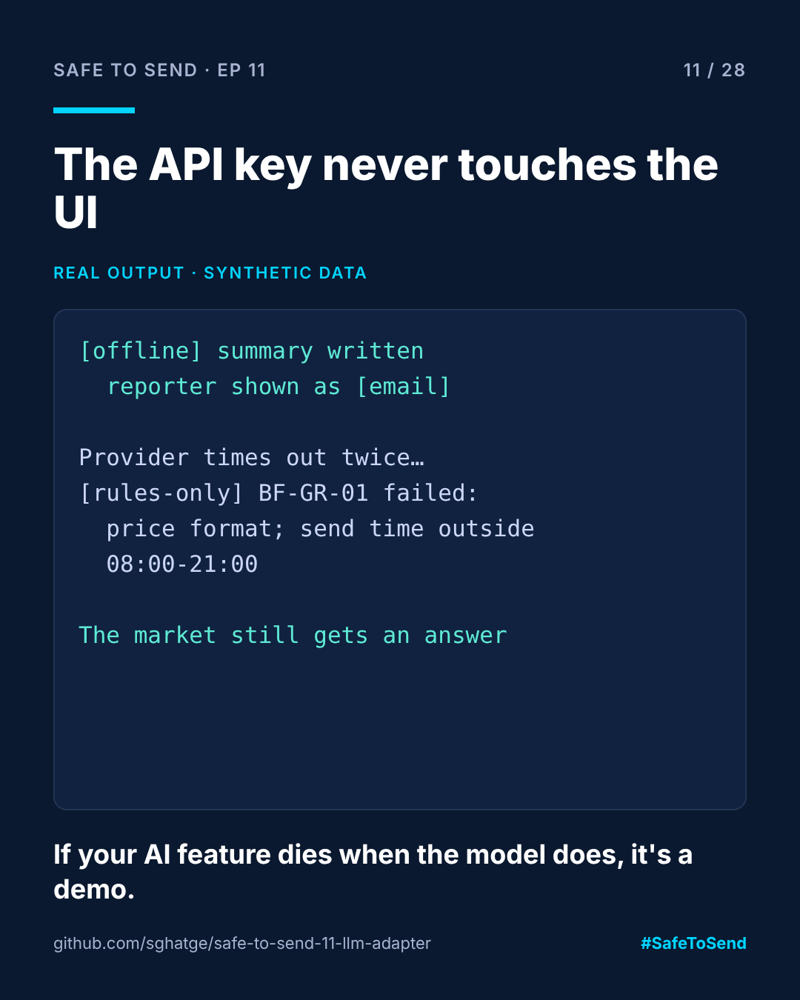

<div align="center">


**SAFE TO SEND · GOVERNED AI ENGINEERING SERIES · SAFE TO SEND 11 LLM ADAPTER**

[GitHub Profile](https://github.com/sghatge) · [Portfolio](https://sghatge.github.io/adobe-campaign-v8-governance/)

</div>

---

# safe-to-send-11 · An LLM Adapter That Fails Safe



**Safe to Send · Episode 11** — a 28-day learn-in-public series on governing AI in CRM operations.

> If your AI feature dies when the model does, it's a demo, not a tool.

## The real-world scenario

A demo app puts the model API key in the frontend. Someone pushes it to GitHub. Separately, on the busiest send day of the year, the model provider has a slow hour, and the QA tool the team now depends on just spins.

## What this adapter does

| Concern | How it's handled |
|---|---|
| API key | Read from an environment variable on the server. Never in code, UI, logs or reports |
| Personal data | Emails and phone numbers redacted before the prompt leaves the process |
| Slow or failing model | Timeout, one retry with exponential backoff |
| Model down | Returns the rules-only answer, labelled as such, so work continues |
| No key at all | Runs with an offline provider, so the repo works for anyone who clones it |

## Run it

```bash
python llm_adapter.py                                   # offline, no key needed

export LLM_PROVIDER=anthropic ANTHROPIC_API_KEY=... LLM_MODEL=<model id>
python llm_adapter.py                                   # real model
```

## Real example output (offline)

```
[offline] Summary (offline template): {"delivery": "BF-GR-01", "verdict": "fail", "issues": [...], "reported_by": "[email]"}

[rules] [rules-only: model unavailable (TimeoutError)] BF-GR-01 failed: price format; send time outside 08:00-21:00.
```

Notice `[email]`: the reporter's address never left the process. And when the provider timed out twice, the market still got an answer.

## Use it

```python
from llm_adapter import explain
text, source = explain(findings_dict, rules_only_text)   # source is the provider name, or "rules"
```

Show `source` in your UI, so people always know whether a model wrote what they're reading.

MIT · [Sangram Ghatge](https://www.linkedin.com/in/sangram-g-2369705b) · #SafeToSend


---

## Portfolio integration & safe use

This repository is part of the **Safe to Send** 28-episode engineering series on governed AI for CRM and marketing operations.

- [Series index and episode map](https://github.com/sghatge/safe-to-send-21-series-map)
- [Complete portfolio](https://github.com/sghatge/sghatge)
- [OPSFORGE Build Lab](https://sghatge.streamlit.app/) — portfolio overview; this repository remains independently usable without the Build Lab.

**Safe-use boundary:** use the supplied examples and synthetic data for evaluation. Review the implementation, dependencies and tests before adapting it. Do not connect it to a production CRM, customer dataset or activation endpoint without a separate security, privacy and change-control review. No production integration or deployment is implied by this repository.
